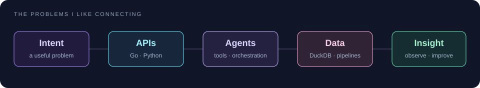

 

<a href="https://anand-bora.vercel.app/"><b>Portfolio</b></a> &nbsp;·&nbsp;
<a href="https://www.linkedin.com/in/anand-bora/"><b>LinkedIn</b></a> &nbsp;·&nbsp;
<a href="https://flid.ai/"><b>flid.ai</b></a> &nbsp;·&nbsp;
<a href="mailto:anandbora241@gmail.com"><b>Email</b></a>

## 👋 About me

<table>
<tr>
<td width="62%" valign="top">

I'm **Anand**, an **AI Engineer at [Flid AI](https://flid.ai/)**, where I help build **[LeapView](https://github.com/flidai/leapview)**, open-source BI for governed analytics.

I work across the whole stack: product interfaces, backend services, data systems and applied AI. I take features from first idea to production, and I care most about the part around the model: how an agent uses tools, how data moves through a system, and how to keep powerful software simple to use.

</td>
<td width="38%" valign="top">

**At a glance**

- 🏢 AI Engineer, Flid AI
- 📊 Building LeapView
- 📍 Pune, India · remote
- 🎓 Savitribai Phule Pune University
- 💬 Ask me about agents, Go, DuckDB and BI

</td>
</tr>
</table>

## 🚀 Now building: LeapView

<table>
<tr>
<td valign="top">

### 📊 [LeapView](https://github.com/flidai/leapview) &nbsp;at [Flid AI](https://flid.ai/)

**Open-source BI for governed analytics, without the lock-in.** Dashboards as code, a governed semantic layer, and AI agents that build within the rules a data team sets.

| Area | What I've shipped |
| :-- | :-- |
| 🤖 **Agent workflows** | Chat that builds dashboards, previews charts and saves visuals into reports |
| 🔎 **Data Explorer** | Governed exploration with saved results, sharing and export |
| 📋 **Tables & charts** | Hierarchical tables, image cells, streamed table windows, readable chart layouts |
| 🔐 **Security & admin** | Sessions, roles and permissions, SSO flows, encrypted credentials, audit logs |
| 🧰 **Developer experience** | Local-first project setup, a reproducible `init` CLI, a component playground |
| 🚢 **Delivery** | Hosted demo staging and rollouts |

**[Explore LeapView →](https://github.com/flidai/leapview)** &nbsp;·&nbsp; **[Visit flid.ai ↗](https://flid.ai/)**

</td>
</tr>
</table>

## 💼 Experience

| | Role | Highlights |
| :-- | :-- | :-- |
| 🚀 | **AI Engineer** · [Flid AI](https://flid.ai/) Aug 2026 – present · Remote | Building [LeapView](https://github.com/flidai/leapview) across agents, analytics, the UI and delivery. |
| 🐍 | **Python Developer Intern** · aiadventures Jan – Feb 2025 · Pune | Automated attendance analysis with Python and the Google Sheets API ([Absence Detection](https://github.com/Anand-Bora-0001/Absence-Detection-System)), and built a full-stack [certificate generator](https://github.com/Anand-Bora-0001/Bulk-Certificate-Generator) with Flask. |
| ☕ | **Java Developer Intern** · ShadowFox Feb 2025 · Remote | Built five Java projects, from a JUnit-tested banking system to a Spring Boot [microservices store](https://github.com/Anand-Bora-0001/Ecommerce-App) ([all work](https://github.com/Anand-Bora-0001/ShadowFox)). |

## ✨ Featured projects

<table>
<tr>
<td width="50%" valign="top">

### 🍯 [HoneyCloud-X](https://github.com/Anand-Bora-0001/HoneyCloud-X)
AI-powered cybersecurity platform for real-time threat detection, classification and monitoring. Co-built with Ganesh Kambli.

`FastAPI` `React` `PostgreSQL` `Machine learning`

</td>
<td width="50%" valign="top">

### 🛡️ [SentinelGrid AI](https://github.com/Anand-Bora-0001/SentinelGrid-AI)
Cyber resilience for critical infrastructure: behavioural anomaly detection, threat intelligence and automated response.

`FastAPI` `React` `scikit-learn` `Redis` `Docker`

</td>
</tr>
<tr>
<td width="50%" valign="top">

### 📈 [Amex Pulse](https://github.com/Anand-Bora-0001/amex-pulse)
Customer journey intelligence with cross-channel replay, churn-risk detection, explainable recommendations and a real-time agent console.

`FastAPI` `Kafka` `WebSockets` `React`

</td>
<td width="50%" valign="top">

### 🌊 [Real-Time Data Platform](https://github.com/Anand-Bora-0001/Real-Time-Data-Engineering-Platform)
Streaming data platform with data quality checks, ML inference and one operations dashboard.

`Kafka` `Spark` `Airflow` `Delta Lake` `Terraform`

</td>
</tr>
<tr>
<td width="50%" valign="top">

### 🧬 [Enterprise MLOps Platform](https://github.com/Anand-Bora-0001/Enterprise-MLOps-Platform)
Datasets, experiment tracking, background training, deployment and real-time inference in one platform.

`MLflow` `Celery` `Kubernetes` `Prometheus`

</td>
<td width="50%" valign="top">

### 🗂️ [Enterprise Data Platform](https://github.com/Anand-Bora-0001/Enterprise-Data-Platform)
Data governance and analytics: metadata discovery, data quality, lineage, PII compliance and AI-assisted search.

`FastAPI` `PostgreSQL` `React` `Grafana`

</td>
</tr>
</table>

<b>More builds</b>

 

- 🛰️ **[Observability Platform](https://github.com/Anand-Bora-0001/observability-platform)**: IAM and cloud observability with OAuth2/OIDC, event-driven services and incident management.
- ☁️ **[Cloud Monitoring Dashboard](https://github.com/Anand-Bora-0001/cloud-monitoring-dashboard)**: monitoring for AWS, Azure, GCP and Kubernetes, with capacity forecasting.
- 📄 **[ResumeIQ AI](https://github.com/Anand-Bora-0001/resumeiq-ai)**: resume review that scores ATS compatibility and suggests job-specific fixes.
- 🔒 **[SVF](https://github.com/Anand-Bora-0001/SVF)**: a secure virtual file system in C++ with role-based access and SHA-256 password hashing.

**[See all repositories →](https://github.com/Anand-Bora-0001?tab=repositories)**

## 🧰 Tech stack

<table>
<tr><td><b>Languages</b></td><td></td></tr>
<tr><td><b>Backend</b></td><td></td></tr>
<tr><td><b>Data &amp; AI</b></td><td> &nbsp; </td></tr>
<tr><td><b>Frontend</b></td><td></td></tr>
<tr><td><b>Cloud &amp; DevOps</b></td><td></td></tr>
</table>

## 📊 GitHub activity

<picture>
  <source media="(prefers-color-scheme: dark)" srcset="https://raw.githubusercontent.com/Anand-Bora-0001/Anand-Bora-0001/output/github-contribution-grid-snake-dark.svg" />
  <source media="(prefers-color-scheme: light)" srcset="https://raw.githubusercontent.com/Anand-Bora-0001/Anand-Bora-0001/output/github-contribution-grid-snake.svg" />
  
</picture>

My contribution calendar, refreshed daily.

<b>More from my GitHub</b>

 

<b>Recent public activity</b>

 

<!--START_SECTION:activity-->
1. 🎉 Merged PR [#2](https://github.com/Anand-Bora-0001/Anand-Bora/pull/2) in [Anand-Bora-0001/Anand-Bora](https://github.com/Anand-Bora-0001/Anand-Bora)
<!--END_SECTION:activity-->

## 🤝 Let's connect

I'm always happy to talk about **AI agents, analytics, backend systems and open source**. If you're working on something in that space, say hello.

